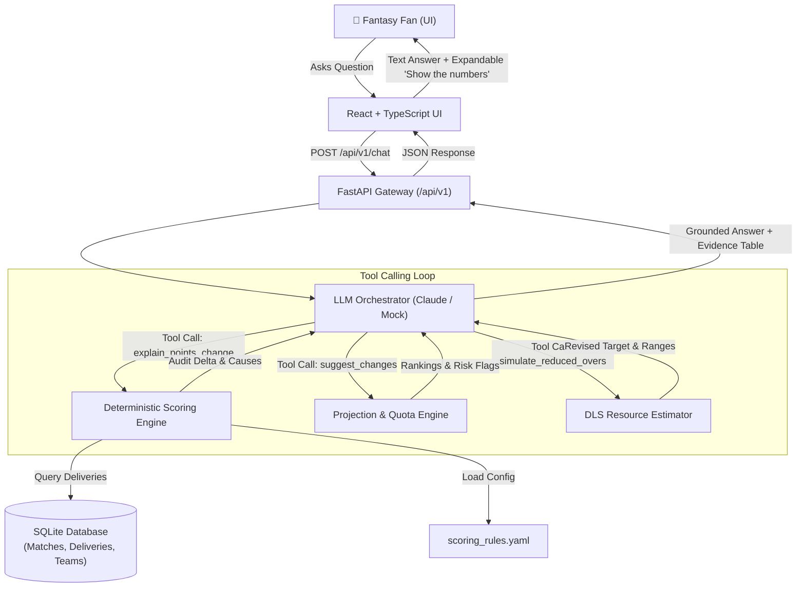

# Match Copilot 🏏🤖

> **Explainable AI Assistant for Fantasy Cricket Fans During Live Matches**  
> *Sample data. Not official Dream11 scoring.*

[]()
[]()
[]()

---

## 1. The Fan Problem

During a live T20 cricket match, fantasy players watch their team points fluctuate without knowing why:
- *Why did my rank drop 20,000 places in the last over?*
- *Did my captain fail, or did an opponent's bowler take an unheralded 3-wicket haul?*
- *Should I have picked a death bowler instead of an opener?*
- *What happens to my team if rain cuts the match to 15 overs?*

Fans panic because fantasy apps provide **raw numbers without narrative, and opaque rank drops without attribution**. Match Copilot solves this by delivering **fast, trustworthy, plain-language answers backed by 100% deterministic mathematical evidence**.

---

## 2. Core Design Principle: The LLM Never Does Math

> [!IMPORTANT]
> **Non-Negotiable Rule:** The LLM must **NEVER** calculate fantasy points, projected scores, or DLS resource reductions itself.

Large Language Models (LLMs) are probabilistic token predictors prone to arithmetic hallucinations, inconsistent totals, and lack of auditability. In fantasy sports, where rankings and points determine real outcomes, hallucinations destroy fan trust.

### How Match Copilot Solves This (Traceable & Explainable AI):
1. **Separation of Concerns:** All numbers come exclusively from deterministic pure-function engines written in Python (`scoring_engine`, `projection_engine`, `dls_estimator`).
2. **Tool Calling Interface:** When a fan asks a question, the LLM decides which analytical tool to call (`explain_points_change`, `suggest_changes`, or `simulate_reduced_overs`).
3. **Structured Evidence:** The backend engine runs the exact math, saves the ball-by-ball attribution, and passes both a structured summary and an **evidence table** back to the LLM.
4. **Grounded Narrative:** The LLM only explains, highlights nuances, advises, and converses in English or natural Hinglish. Every number cited in the answer maps 1:1 to an audited cell in the evidence table.

---

## 3. Architecture & Data Flow



---

## 4. Key Features

### 1. EXPLAIN: *"Why did I lose / gain points?"*
- Compares your team's fantasy points between two match moments (e.g. over 2 to 3, or last 5 overs).
- Traces every single point movement to ball-by-ball causes:
  - Wickets (+25 pts) and bowled/LBW bonuses (+8 pts)
  - Boundaries (4s and 6s)
  - Duck penalties (-2 pts for top-order dismissals on 0)
  - Maiden overs (+12 pts)
  - Captain (2.0x) and Vice-Captain (1.5x) multipliers

### 2. ADVISE: *"Should I change my captain?"*
- Rest-of-match points projection engine.
- Detects critical risk flags:
  - `Batter already dismissed`: 0 remaining batting points possible.
  - `Quota exhausted`: Bowler completed all 4 overs, cannot bowl further.
- Generates 2-3 tactical fixes with transparent reasoning and ranks all 11 players by captaincy potential.

### 3. WHAT-IF / ESTIMATE: *"What if rain cuts it to 15 overs?"*
- Deterministic Duckworth-Lewis-Stern (DLS) resource curve calculation.
- Clearly labelled: **"Approximate DLS-style Revised Target (Prototype model)"**.
- Player points projected strictly as **RANGES** (`low / expected / high`) with confidence notes, never fake-precise numbers.

---

## 5. Tech Stack

- **Backend:** Python 3.11+, FastAPI, Pydantic v2, SQLAlchemy 2.0 + SQLite, Alembic migrations, Pytest, Pydantic-Settings.
- **LLM Layer:** Anthropic Claude API with tool calling + Deterministic Mock LLM mode (runs offline without any API keys).
- **Frontend:** React 18, TypeScript (strict mode, zero `any`), Vite, Tailwind CSS, Lucide icons.
- **Rules Configuration:** External `scoring_rules.yaml` (never hardcoded in business logic).
- **Deployment:** Single multi-stage `Dockerfile`, `render.yaml`.

---

## 6. Run Locally in Under 5 Commands

### Prerequisites
- Python 3.11+
- Node.js 18+ and npm

### Steps:
```bash
# 1. Clone repository
git clone https://github.com/YuvMukhi/Match-Copilot.git
cd Match-Copilot

# 2. Setup Python environment and install backend dependencies
python -m venv .venv
.\.venv\Scripts\pip install -r backend\requirements.txt   # Windows (use source .venv/bin/activate on Linux/Mac)

# 3. Seed sample match data and run migrations
$env:PYTHONPATH="backend/app;backend"; .\.venv\Scripts\python -m app.db.seed

# 4. Install frontend dependencies and build SPA
cd frontend && npm install && npm run build && cd ..

# 5. Start unified FastAPI server (serves API + Frontend on one port)
.\.venv\Scripts\uvicorn app.main:app --app-dir backend --reload --port 8000
```
Open your browser at **http://localhost:8000** to use Match Copilot!

*(Optional: Set `USE_MOCK_LLM=false` and `ANTHROPIC_API_KEY=your_key` in `.env` to enable live Claude 3.5 Sonnet).*

---

## 7. Testing & Linting

```bash
# Run backend test suite (28 comprehensive unit & integration tests)
$env:PYTHONPATH="backend/app;backend"; .\.venv\Scripts\pytest backend\tests

# Run backend linter
.\.venv\Scripts\ruff check backend

# Run frontend typecheck and linter
cd frontend && npm run build && npm run lint
```

---

## 8. Deployment

### Render One-Click Deploy (`render.yaml`)
A `render.yaml` configuration is included at the root of the repository. Simply connect your GitHub repository to Render, and it will deploy the Docker service automatically with health checks on `/health`.

### Docker Container
```bash
docker build -t match-copilot .
docker run -p 8000:8000 match-copilot
```

---

## 9. Limitations & Future Work

- **Prototype Data:** Currently loads one 20-over T20 match ball-by-ball. Future iterations will connect to live Cricinfo/Sportmonks WebSockets for real-time streaming matches.
- **Proprietary DLS Software:** Official ICC DLS uses proprietary non-linear software. Our model uses standard published T20 resource tables and labels all targets clearly as approximate ranges.
- **League Rules:** Illustrated using standard T20 fantasy points. Users in future releases can upload or customize their private league's rule YAML in the UI.

---
*Disclaimer: Sample data created for demonstration purposes. Not an official Dream11 or ICC product.*
